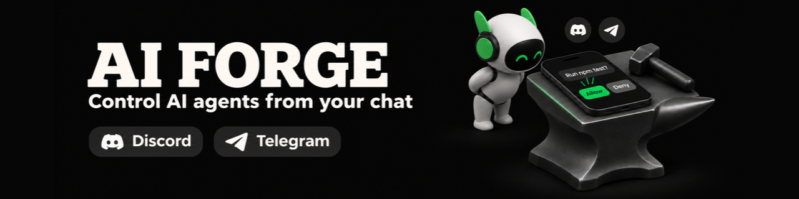
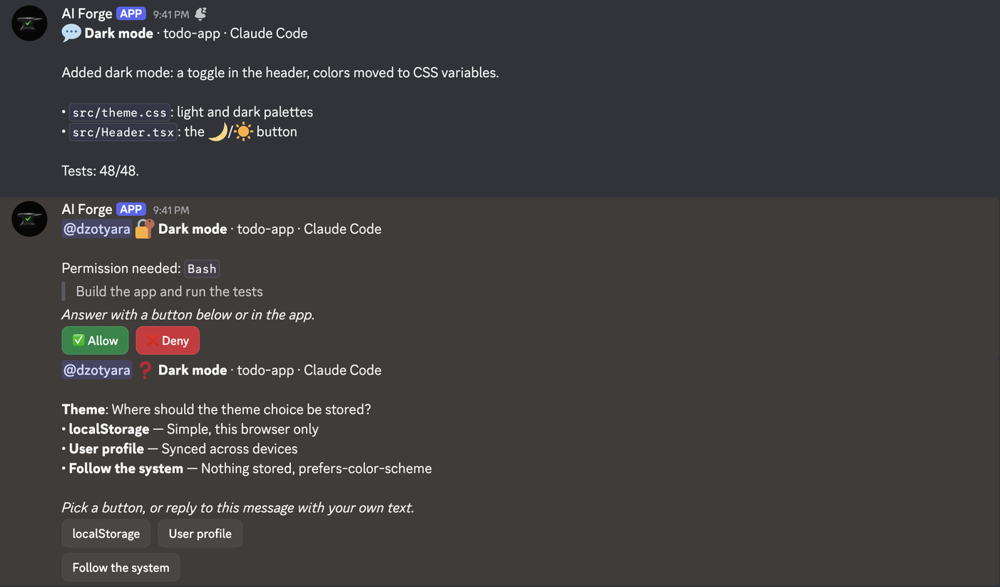
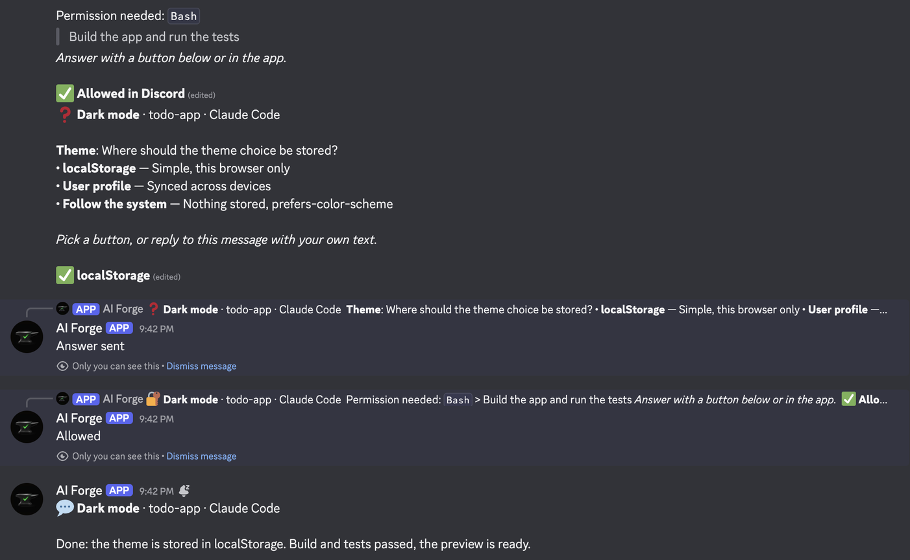
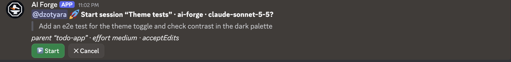
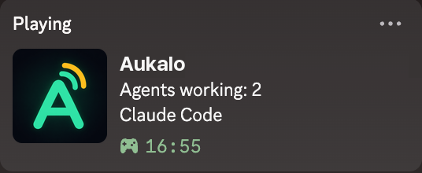
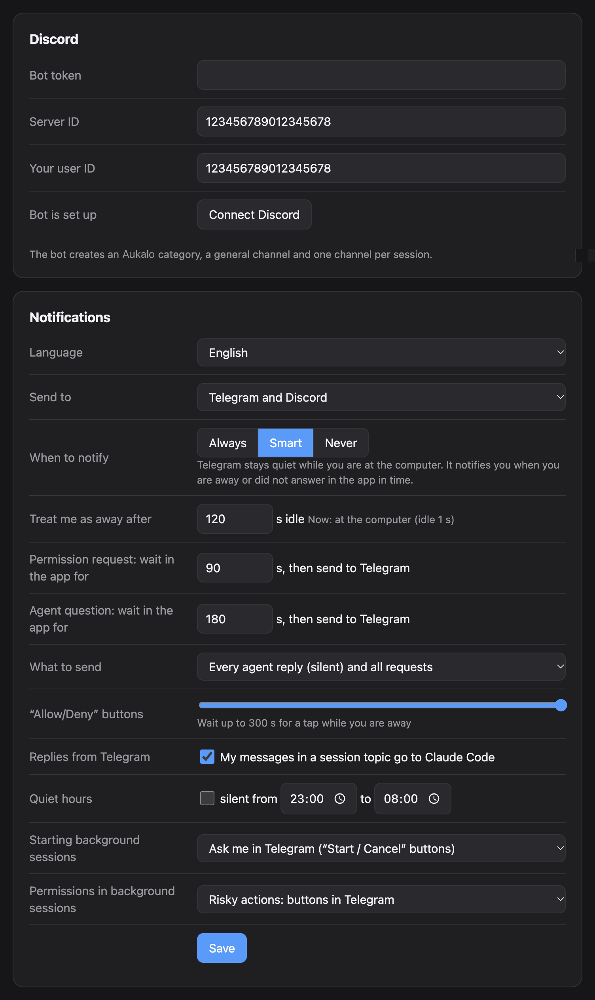
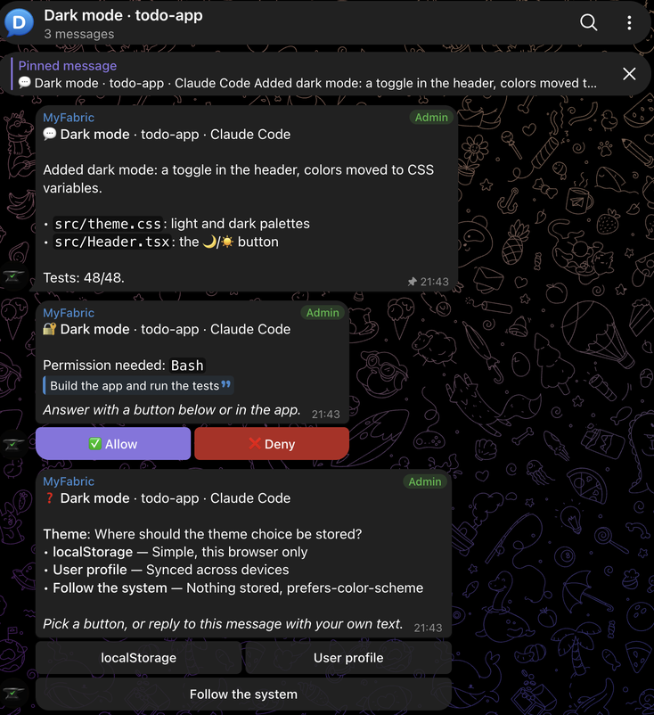
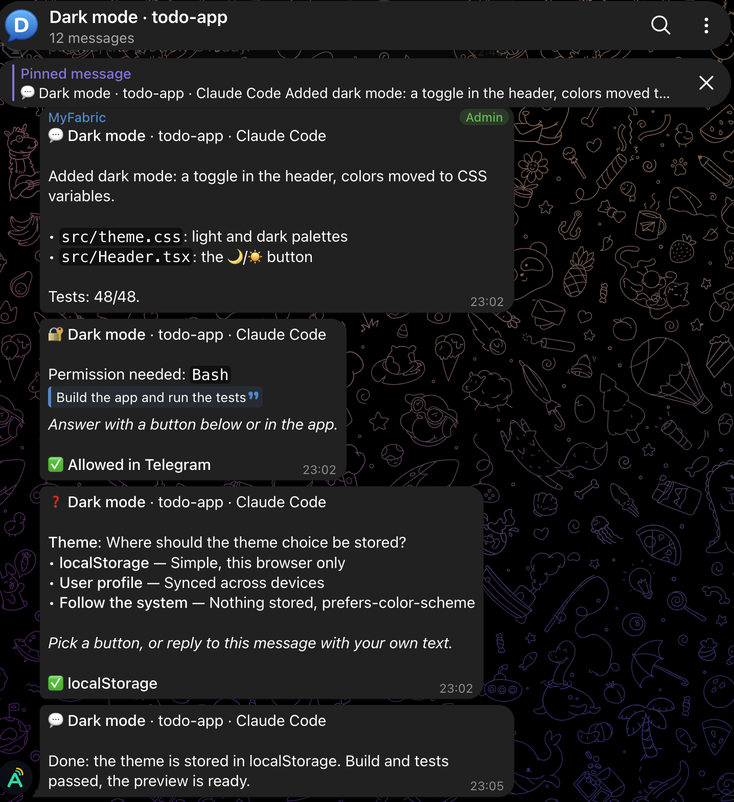

<p align="center">
  
</p>

<p align="center">
  <b>Claude Code sessions in Discord and Telegram</b><br>
  Approve, answer and reply from your phone while your agents keep working on your Mac
</p>

<p align="center">
  <a href="https://github.com/dzotyara/ai-forge/stargazers"></a>
  <a href="https://github.com/dzotyara/ai-forge/actions/workflows/test.yml"></a>
  
  
</p>

<p align="center">
  <b>English</b> · <a href="README.ru.md">Русский</a>
</p>

> ⭐ If AI Forge saves you a trip to your laptop, please star the repo. It helps other people find it and tells me it's worth building further.

## What it is

AI Forge is a Claude Code plugin. Every session gets its own Discord channel (or Telegram topic), and anything that needs a human shows up there with buttons:

- a permission request for a command or an edit: **Allow** / **Deny**
- a multiple-choice question (`AskUserQuestion`): one button per option
- "I need you" turns (`ACTION_REQUIRED`) and the next-step question at the end of a turn
- a summary of every finished turn, posted silently

Reply with plain text in the channel and the session wakes up and keeps going. No need to walk back to your laptop.

<p align="center">
  
</p>

## Features

| | Discord | Telegram |
|---|---|---|
| A channel or topic per session | ✅ private `🤖・<name>` channel | ✅ forum topic |
| Buttons for permissions and questions | ✅ | ✅ |
| A text reply or a reply-to wakes the session | ✅ | ✅ |
| Allow once what auto mode blocked | ✅ | ✅ |
| A Boss session in the main channel, background sessions on demand | ✅ `🔥・general` | ✅ General |
| `/status` `/away` `/here` `/mute` | ✅ slash commands | ✅ |
| Quiet by default, a ping only when you're needed | ✅ | ✅ smart delivery |
| "Playing AI Forge" on the bot and on your profile | ✅ | — |
| English and Russian interface | ✅ | ✅ |

Use Discord, Telegram, or both. With both, a request shows up in both places and the first answer wins.

## Screenshots

| | |
|---|---|
|  |  |
| A permission and a question answered from Discord; only you see the confirmation | The Boss asks before starting a background session |
|  |  |
| Your Discord profile shows how many agents are working | The local settings panel, with an English / Русский switch |
|  |  |
| The same session in a Telegram topic | Allowed and answered from Telegram, then a reply |

## Install

You need Claude Code and Node.js 22+. Presence detection (whether you're at your computer) works on macOS; on other systems you're treated as away.

```bash
claude plugin marketplace add dzotyara/ai-forge
claude plugin install ai-forge@ai-forge
```

Open the settings panel:

```bash
node "$(ls -d ~/.claude/plugins/cache/ai-forge/ai-forge/*/ | tail -1)configure.mjs" --ui
```

The panel is local: it listens on `127.0.0.1` with a random key, never shows full tokens and never sends them anywhere. Pick **English** or **Русский** there.

Start a new session afterwards, or run `/reload-plugins` in an open one.

### Discord

1. Create an application in the [Discord Developer Portal](https://discord.com/developers/applications). On the **Bot** tab turn on **Message Content Intent** and press **Save Changes**.
2. Invite the bot to your server with **Manage Channels**, **View Channel**, **Send Messages**, **Read Message History** and **Add Reactions**. Add **Manage Server** if you want the bot to set the server icon.
3. In the panel, **Discord** section: the bot token and your user ID (right-click yourself → Copy User ID; needs Developer Mode). The server ID is only needed if the bot is on several servers. Press **Connect Discord**.
4. In **Notifications → Where to send**, pick **Discord** or **Telegram and Discord**, save, and press **Test message**.

The bot creates an `AI Forge` category with a `🔥・general` channel and makes a channel for each session on its own. Only you and the bot see them (server owners keep access through Discord permissions). The bot takes commands and button presses from you only.

If the bot has no avatar and the server has no icon, the bot sets the anvil picture. It never replaces pictures you chose. It also switches the server's default notifications to "Only @mentions".

### Telegram

1. Create a bot with [@BotFather](https://t.me/BotFather).
2. Create a group, turn on **Topics**, add the bot and make it an admin with "Manage topics".
3. Enter the token in the panel and press **Find groups**, or run the wizard: `node <plugin>/configure.mjs`.

A private chat with the bot works too: turn on Threaded Mode for the bot in @BotFather so sessions get their own topics.

## How to use it

**Reply to a session.** Write in its channel. The bot reacts with 👀, the session wakes up and gets your text. Replying to a specific message works too. A session listens for 12 hours after its last turn.

**Permissions.** Every permission request comes with buttons. The prompt in the app works at the same time: whichever answers first wins, and the other message is marked "Decided in the app".

**Auto mode.** When the auto-mode classifier blocks an action, the channel gets what was blocked and why. **Allow once** allows exactly that call in that session for 30 minutes, and the session retries it.

**The Boss.** Name any session "Boss" and it takes the main channel (`🔥・general`, or General in Telegram). Drop a task there; the Boss splits it across project sessions and starts background ones (`claude -p`) after you press **▶️ Start**. If the app closed the Boss, a message in the main channel wakes it up in the background.

**Commands** (yours only):

| Command | What it does |
|---|---|
| `/status` | mode, presence and the list of sessions |
| `/away` | send everything right away for 12 hours, or until `/here` |
| `/here` | smart mode |
| `/mute 30m`, `/mute 2h`, `/mute off` | pause |

### When you get notified

By default AI Forge stays quiet while you're at your computer and pings you only when it needs you:

| Event | You're away | You're at your Mac |
|---|---|---|
| Permission request or question | right away, with a ping | after 90 s, if you haven't answered in the app |
| The agent needs you | right away, with a ping | after 180 s, if you haven't answered |
| A turn finished | silently | not sent |

In Discord every message is silent, and only the ones that need you mention you. During quiet hours (`quietHours`) the mention stays but makes no sound.

### Discord status

While the background service runs, the bot shows "Playing AI Forge · working: N", where N counts every agent working right now: sessions in the middle of a turn or writing to their transcript in the last 90 seconds, child sessions, background sessions, and each running subagent. If Discord is open on the same Mac, your own profile shows it too: how many agents are working, for how long, and a button to this repo for people who look at your profile (Discord hides your own buttons from you). This needs **Settings → Activity Privacy → Share my activity** in Discord.

## Settings

Everything is in the panel or in `~/.codex/telegram-action-notifier/config.json`. A missing key means the default.

| Key | Default | What it does |
|---|---|---|
| `language` | `en` | `ru` for the Russian interface |
| `notificationTarget` | `telegram` | `discord` or `both` |
| `deliveryMode` | `smart` | `always`: send right away; `never`: send nothing |
| `notify` | `all` | `action`: skip ordinary turns |
| `approvalWaitSec` | `42900` (almost 12 h) | how long buttons wait; `0`: no buttons |
| `presenceIdleSec` / `approvalGraceSec` / `actionGraceSec` | `120` / `90` / `180` | smart delivery thresholds |
| `quietHours` | none | `{"from":"23:00","to":"08:00"}`: no sound |
| `chatReplies` | `true` | `false`: ignore replies |
| `telegramDenials` | `true` | `false`: don't send auto-mode blocks |
| `bossRevive` | `true` | `false`: don't wake a stopped Boss |
| `spawnConfirm` | `telegram` | `never`: start background sessions without asking |
| `workerPermissions` | `telegram` | `auto`: background sessions run in `auto` mode |
| `workerDefaults` | Sonnet 5.5, medium, `acceptEdits` | model, effort and mode for background sessions |
| `discordActivity` | `AI Forge` | the bot's status; `""` hides it |
| `discordRichPresence` | `true` | `false`: no status on your profile |

## Security

- Tokens and chat IDs are stored locally only (`0600`), never in the repo or logs; secrets are cut out of messages.
- The bot listens to its owner only: other people's messages and presses are silently ignored.
- Background sessions can't use `bypassPermissions`. They ask with buttons for risky commands unless you chose `workerPermissions: "auto"`.
- The profile status goes through Discord's local socket, with no token.

## Codex

In Codex, AI Forge only sends: permission requests and "I need you" turns arrive in Discord or Telegram, and you answer in Codex.

```bash
codex plugin marketplace add dzotyara/ai-forge --ref main
codex plugin add ai-forge@ai-forge
```

## Development

```bash
node --test plugins/ai-forge/tests/*.test.mjs
```

Tests never touch the network: Telegram, Discord and Discord's socket are stubbed. The suite runs in Russian (`tests/lang-ru.mjs`); English checks import `tests/lang-en.mjs` first. Bump the version in both manifests: `plugins/ai-forge/plugin.json` and `plugins/ai-forge/.claude-plugin/plugin.json`.

---

<p align="center">
  Like it? <a href="https://github.com/dzotyara/ai-forge">⭐ Star the repo</a>. It's the best thank-you.
</p>
