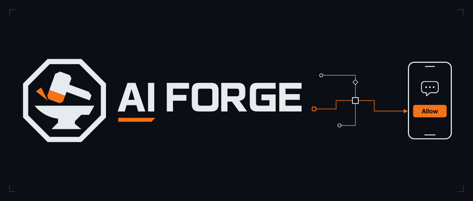
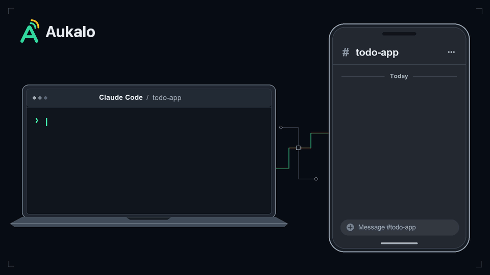
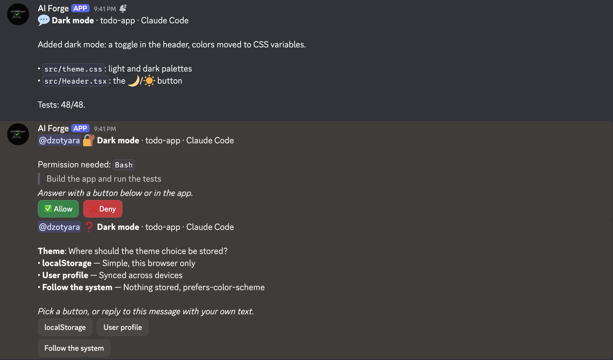
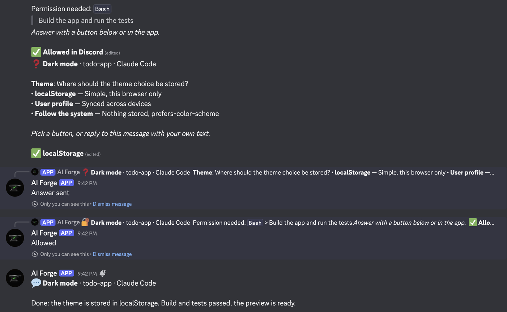
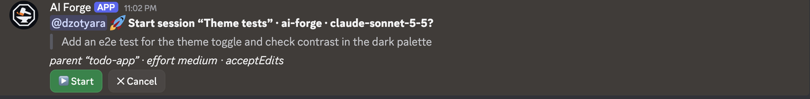
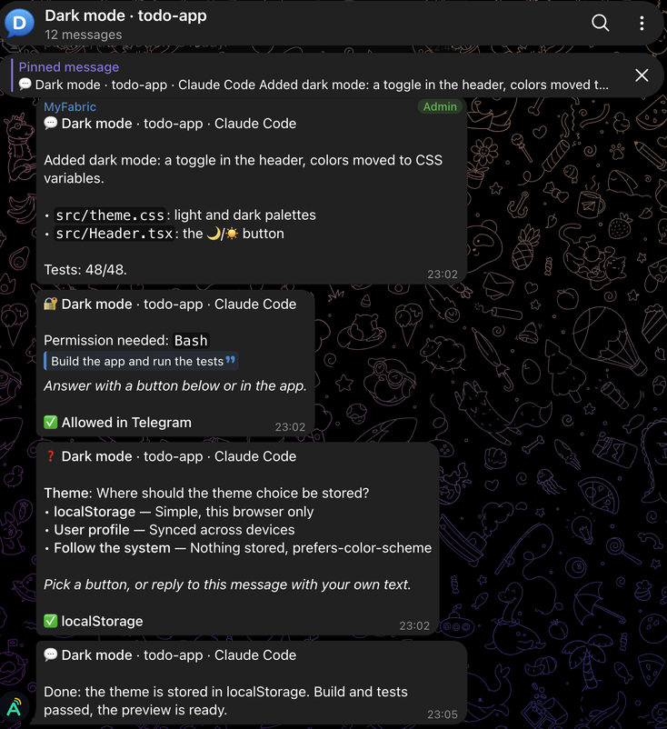
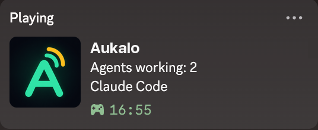
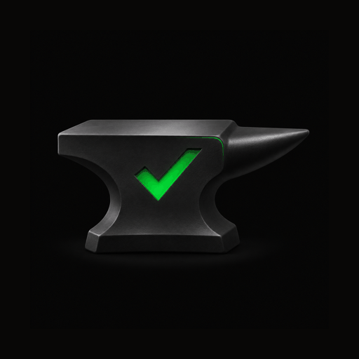
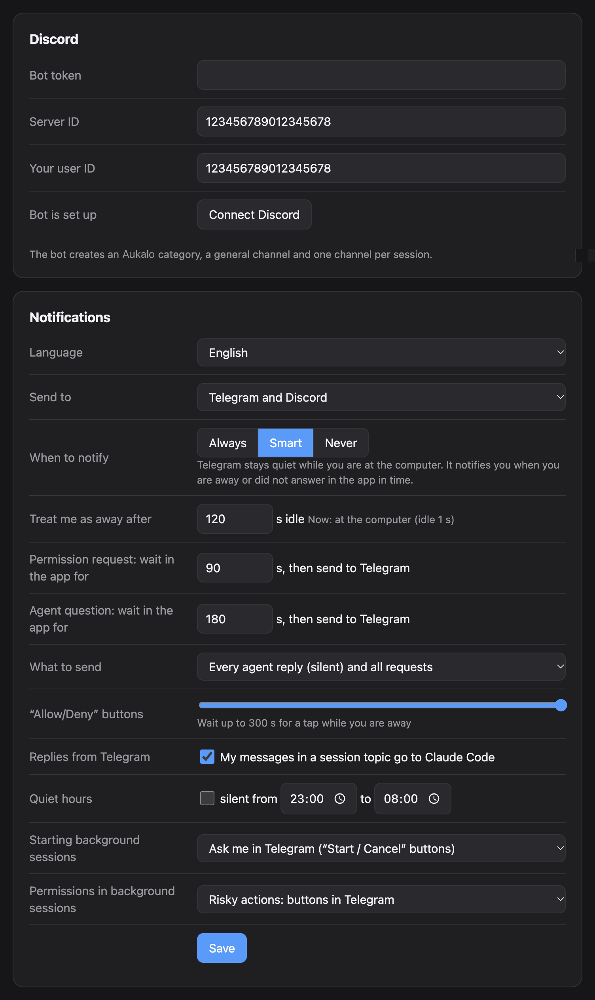
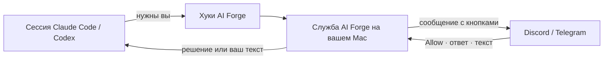

<p align="center">
  
</p>

<h1 align="center">Ваши ИИ-агенты больше не ждут вас</h1>

<p align="center">
  <b>AI Forge превращает Discord и Telegram в пульт управления Claude Code.</b><br>
  Разрешайте, отвечайте и направляйте каждую сессию с телефона, пока работа идёт на вашем Mac.
</p>

<p align="center">
  <a href="#install-30"></a>
  <a href="#demo"></a>
  <a href="https://github.com/dzotyara/ai-forge"></a>
  <a href="https://boosty.to/dzotyara"></a>
</p>

<p align="center">
  <a href="https://github.com/dzotyara/ai-forge/actions/workflows/test.yml"></a>
  
  
  
  
</p>

<p align="center">
  ⭐ <b>Если AI Forge экономит вам время, <a href="https://github.com/dzotyara/ai-forge">поставьте звезду</a>.</b> Так проект проще найти другим.
</p>

<p align="center">
  <a href="README.md">English</a> · <b>Русский</b>
</p>

---

## Проблема

Вы даёте Claude Code большую задачу и отходите. Через пять минут он упирается в *«Разрешить эту команду?»* и ждёт. Вы возвращаетесь через час, а сессия стоит, и кофе остыл.

## Решение

AI Forge присылает каждый момент, где нужны вы, в чат, который у вас и так открыт, и сразу с кнопками. Одно нажатие, и агент снова работает.

<p align="center"></p>

<table>
<tr>
<td width="33%" valign="top">

### ✅ Разрешайте откуда угодно
Запросы разрешений, вопросы с вариантами и «нужно ваше действие» приходят с кнопками **Allow / Deny** и вариантами ответа. Запросы Codex тоже, даже с другого компьютера.

</td>
<td width="33%" valign="top">

### 💬 Говорите с каждой сессией
У каждой сессии свой приватный канал. Ответьте обычным текстом, и сессия проснётся и продолжит, как будто вы написали в приложении.

</td>
<td width="33%" valign="top">

### 🔥 Управляйте командой через Босса
Напишите задачу в общий канал. Босс раздаст её по сессиям, запустит фоновых исполнителей после вашего **▶️ Start** и отчитается.

</td>
</tr>
</table>

<p align="center">
  <b>1 нажатие</b>, чтобы разрешить · <b>0 серверов</b> для хостинга · <b>100%</b> токенов остаются у вас
</p>

<a id="demo"></a>

## Посмотреть в деле

### Discord

**1. Приходит запрос.** Сессия присылает итог хода, запрос разрешения с кнопками и вопрос с вариантами.

<p align="center"></p>

**2. Вы отвечаете с телефона.** Разрешено и отвечено в Discord; подтверждение видите только вы, а сессия работает дальше.

<p align="center"></p>

**3. Босс спрашивает перед запуском фоновой сессии.**

<p align="center"></p>

### Telegram

<table>
  <tr>
    <td width="50%" align="center"><br><sub>Та же сессия в теме Telegram</sub></td>
    <td width="50%" align="center"><br><sub>Разрешено и отвечено из Telegram</sub></td>
  </tr>
</table>

### Профиль Discord и панель настроек

<table>
  <tr>
    <td width="62%" align="center"></td>
    <td width="38%" align="center"></td>
  </tr>
  <tr>
    <td colspan="2"><sub>Пока агенты работают, профиль Discord показывает «Playing AI Forge» и сколько их, а тем, кто смотрит профиль, — кнопку на этот репозиторий.</sub></td>
  </tr>
</table>

<details>
<summary><b>Панель настроек</b> (локальная, на английском или русском)</summary>
<p align="center"></p>
</details>

Скриншоты сняты на английском интерфейсе. Русский включается в панели настроек.

## Как это работает



Всё работает на вашем компьютере: небольшая фоновая служба и хуки плагина. Сервера AI Forge нет, аккаунт заводить не нужно. Токены ботов не покидают ваш компьютер.

## Возможности

| | Discord | Telegram |
|---|---|---|
| Приватный канал или тема на каждую сессию | ✅ `🤖・<название>` | ✅ тема в группе |
| Кнопки разрешений и вопросов | ✅ | ✅ |
| Ответ текстом будит сессию | ✅ | ✅ |
| Разрешить один раз то, что заблокировал авто-режим | ✅ | ✅ |
| Подтверждение действий наружу (деплой, отправка, мерж) настоящим запросом разрешения | ✅ | ✅ |
| Босс в общем канале, всегда на связи, фоновые сессии по команде | ✅ `⚒・forge` | ✅ General |
| Подтверждение запросов Codex, в том числе с другого устройства | ✅ | уведомления |
| Тишина по умолчанию, пинг только когда нужны вы | ✅ | ✅ |
| `/status` `/away` `/here` `/mute` | ✅ slash-команды | ✅ |
| «Playing AI Forge» с числом агентов в вашем профиле | ✅ | - |
| Английский и русский | ✅ | ✅ |

Можно включить Discord, Telegram или оба сразу. В режиме «оба» запрос виден в двух местах, а решение принимается один раз.

<a id="install-30"></a>
## Быстрый старт

Нужны Claude Code и Node.js 22+. Умная доставка (определение, что вы за компьютером) работает на macOS, на других ОС считается, что вас нет.

```bash
claude plugin marketplace add dzotyara/ai-forge
claude plugin install ai-forge@ai-forge
```

Откройте панель настроек:

```bash
node "$(ls -d ~/.claude/plugins/cache/ai-forge/ai-forge/*/ | tail -1)configure.mjs" --ui
```

Панель открывается на `127.0.0.1` и скрывает полные значения токенов. Локальный сервис использует их для авторизации в подключённых мессенджерах.

На чистой установке сверху панели открывается **мастер настройки**: он проведёт по Discord или Telegram шаг за шагом. Подробная инструкция с разбором проблем лежит в **[гайде по настройке](docs/SETUP.ru.md)**. По умолчанию интерфейс на английском: выберите **Русский** в разделе **Notifications → Language**.

Подключите Discord или Telegram в мастере и нажмите **Тестовое сообщение**, чтобы проверить доставку. Начните новую сессию Claude Code или выполните `/reload-plugins` в открытой. Для Codex см. [настройку Codex](#codex).

### Discord

1. Создайте приложение в [Discord Developer Portal](https://discord.com/developers/applications). На вкладке **Bot** включите **Message Content Intent** и нажмите **Save Changes**.
2. Добавьте бота на свой сервер с правами **Manage Channels**, **View Channel**, **Send Messages**, **Read Message History**, **Add Reactions**. Чтобы бот сам поставил иконку серверу, дайте ещё **Manage Server**.
3. В панели, раздел **Discord**: токен бота и свой ID пользователя (ПКМ по себе → Copy User ID, нужен режим разработчика). ID сервера - только если бот на нескольких серверах. Нажмите **Подключить Discord**.
4. В **Уведомления → Куда отправлять** выберите **Discord** или **Telegram и Discord**, сохраните и нажмите **Тестовое сообщение**.

Бот создаст категорию `AI Forge` и канал `⚒・forge`, а каналы сессий будет создавать сам. Каналы видят только вы и бот (плюс владельцы сервера через права Discord). Команды и кнопки бот принимает только от вас.

AI Forge может поставить фирменные изображения, если у бота ещё нет аватара или у сервера нет иконки. Ранее выбранные изображения сохраняются. Уведомления сервера по умолчанию переключатся на «Только @упоминания». [Обложка бота PNG](docs/discord-telegram-cover.png) · [Видео для описания в Telegram](docs/telegram-description.mp4) · [Иллюстрация Rich Presence](docs/rich-presence.gif)

### Telegram

1. Создайте бота у [@BotFather](https://t.me/BotFather).
2. Создайте группу, включите в ней **Темы**, добавьте бота и сделайте его администратором с правом «Управление темами».
3. В панели введите токен и нажмите **Найти группы**, либо запустите мастер: `node <плагин>/configure.mjs`.

Можно и без группы, в личке с ботом: тогда в @BotFather включите боту Threaded Mode, чтобы у сессий были свои темы.

## Как пользоваться

**Ответить сессии.** Напишите в её канал. Бот поставит 👀, сессия проснётся и получит ваш текст. Реплай на конкретное сообщение тоже работает. Сессия ждёт ответа до 12 часов после последнего хода. Если она занята длинным ходом, то увидит сообщение на следующем шаге.

**Разрешения.** Кнопки приходят на любой запрос разрешения. Диалог в приложении работает параллельно: кто ответил первым, тот и решил, второе сообщение помечается «Решено в приложении».

**Авто-режим.** Если классификатор авто-режима заблокировал действие, в канал придёт, что именно заблокировано и почему. «✅ Разрешить один раз» разрешает ровно этот вызов в этой сессии на 30 минут, и сессия повторит его.

**Подтверждение действий с телефона.** Ответ из чата не считается согласием на действие, которое касается других людей, например отправить сообщение, задеплоить или влить PR: Claude Code помечает ответы из чата как не ввод пользователя. Поэтому сессия не спрашивает в чате, а взводит `confirm-next` и делает точный вызов. Claude Code спрашивает разрешение, и вам приходит этот вызов с кнопками **Allow** / **Deny** и строкой «Подтвердите: …». Allow разрешает только этот вызов.

**Босс.** Назовите любую сессию «Босс» - она займёт общий канал (`⚒・forge` или General в Telegram). Пишете туда задачу, Босс раскладывает её по проектным сессиям и запускает фоновые (`claude -p`) по кнопке «▶️ Запустить». Босс есть всегда: если приложение его закрыло, сообщение в общий канал разбудит его в фоне, а если Босса нет вовсе (удалён или пропал его разговор), служба сама запустит нового в фоне со стартовым промптом из навыка boss (в папке `bossCwd`, по умолчанию домашняя) и передаст ему ваше сообщение.

**Команды** (только от вас):

| Команда | Что делает |
|---|---|
| `/status` | режим, присутствие и список сессий |
| `/away` | присылать всё сразу, 12 часов или до `/here` |
| `/here` | умный режим |
| `/mute 30m`, `/mute 2h`, `/mute off` | пауза |

### Когда приходит уведомление

AI Forge по умолчанию молчит, пока вы за компьютером, и пингует, только когда нужны вы:

| Событие | Вас нет | Вы за Mac |
|---|---|---|
| Запрос разрешения или вопрос | сразу, с пингом | через 90 с, если не ответили в приложении |
| Нужно ваше действие | сразу, с пингом | через 180 с, если не ответили |
| Обычный ход завершён | тихо, без звука | не отправляется |

В Discord все сообщения приходят без звука, а пингуют вас только те, где нужно действие. В тихие часы (`quietHours`) упоминание остаётся, но без звука. Когда вы ответили в приложении, бот убирает упоминание из этого сообщения.

### Статус в Discord

Пока работает фоновая служба, у бота статус «Playing AI Forge · в работе: N», где N - все агенты, которые работают прямо сейчас: сессии с идущим ходом или с транскриптом, обновлённым за последние 90 секунд, дочерние и фоновые сессии и каждый работающий субагент. Если на этом Mac открыт Discord, тот же статус появляется в вашем профиле: сколько сессий в работе, сколько времени запущено, и кнопка на этот репозиторий для тех, кто смотрит ваш профиль. Для этого в Discord должно быть включено **Настройки → Конфиденциальность активности → Share my activity**.

### Несколько устройств и Codex

Счёт идёт по всем вашим устройствам. Каждое устройство держит одну строку в приватном канале `📡・presence`: имя, сколько работает агентов Claude Code и сессий Codex, когда отчиталось. Служба на каждом устройстве складывает строки не старше двух минут, а статус показывает, где идёт работа, например «Claude Code · Codex».

- Codex на этом же Mac считается по `~/.codex/sessions`.
- На устройстве, где есть только Codex, настройте AI Forge с тем же Discord-ботом. Хуки Codex запустят там маленький фоновый репортёр. Он выключится сам через 30 минут без работы.
- Устройство, которое уснуло или ушло в офлайн, выпадает из счёта через две минуты.

## Настройки

Всё задаётся в панели или в `~/.codex/telegram-action-notifier/config.json`. Отсутствующий ключ - значение по умолчанию.

| Ключ | По умолчанию | Что делает |
|---|---|---|
| `language` | `en` | `ru` — русский интерфейс |
| `notificationTarget` | `telegram` | `discord` или `both` |
| `deliveryMode` | `smart` | `always` - всегда сразу, `never` - ничего |
| `notify` | `all` | `action` - не присылать обычные ходы |
| `approvalWaitSec` | `42900` (почти 12 ч) | сколько ждать кнопку; `0` - без кнопок |
| `codexApprovalWaitSec` | `900` | сколько запрос Codex ждёт кнопку в Discord; `0` — только уведомление |
| `presenceIdleSec` / `approvalGraceSec` / `actionGraceSec` | `120` / `90` / `180` | пороги умной доставки |
| `quietHours` | нет | `{"from":"23:00","to":"08:00"}` - без звука |
| `chatReplies` | `true` | `false` - не принимать ответы |
| `telegramDenials` | `true` | `false` - не присылать блокировки авто-режима |
| `bossRevive` | `true` | `false` - не будить и не пересоздавать Босса |
| `bossCwd` | домашняя папка | где запускать нового Босса, если его нет |
| `spawnConfirm` | `telegram` | `never` - запускать фоновые сессии без подтверждения |
| `workerPermissions` | `telegram` | `auto` - фоновые сессии в режиме `auto` |
| `workerDefaults` | Sonnet 5.5, medium, `acceptEdits` | модель, effort и режим фоновых сессий |
| `discordActivity` | `AI Forge` | статус бота; `""` - без статуса |
| `discordRichPresence` | `true` | `false` - не показывать статус в вашем профиле |

## Безопасность

- Токены и ID чатов хранятся только локально (`0600`), в репозиторий и логи не попадают, секреты в сообщениях вырезаются.
- Бот слушается только владельца: чужие сообщения и нажатия молча игнорируются.
- Фоновым сессиям запрещён `bypassPermissions`. Рискованные команды они спрашивают кнопками, если вы не выбрали `workerPermissions: "auto"`.
- Статус в профиле идёт через локальный сокет Discord, без токенов.

## Codex

В Codex (0.166+) запросы разрешений приходят в Discord с кнопками **Allow** / **Deny**. Codex ждёт до 15 минут (`codexApprovalWaitSec`, 900 с), потом спрашивает в своём окне. Нажатие принимает служба на машине с Claude Code: она записывает ответ прямо в сообщение, а хук Codex читает его оттуда, поэтому это работает и с другого устройства. Telegram для Codex по-прежнему только уведомляет. После обновления перезапустите Codex и подтвердите новые хуки в **Settings → Hooks**.

```bash
codex plugin marketplace add dzotyara/ai-forge --ref main
codex plugin add ai-forge@ai-forge
```

## Разработка

```bash
node --test plugins/ai-forge/tests/*.test.mjs
```

Тесты не ходят в сеть: Telegram, Discord и сокет Discord подменяются. Версию поднимайте в обоих манифестах: `plugins/ai-forge/plugin.json` и `plugins/ai-forge/.claude-plugin/plugin.json`.

## Вопросы и ответы

**Безопасно ли разрешать действия с телефона?**
Бот слушается только вас, в вашем приватном сервере или группе. Одно разрешение действует ровно на один вызов: вы видите команду или параметры до нажатия. Ответ в чате никогда не считается согласием на деплой или сообщение другому человеку: для этого всегда приходит настоящий запрос разрешения.

**Нужен сервер или подписка?**
Нет. AI Forge - это плагин и небольшая фоновая служба на вашем компьютере. С Discord и Telegram она общается через вашего собственного бота.

**Работает с Codex?**
Да. Запросы Codex приходят в Discord с кнопками Allow / Deny, даже если Codex запущен на другом устройстве, а счётчик агентов учитывает все ваши устройства.

**Windows и Linux?**
Разрешения, ответы и Босс работают везде, где работает Claude Code. Определение присутствия (тишина, пока вы за компьютером) есть только на macOS, на других системах считается, что вас нет.

**Сколько стоит?**
Нисколько. AI Forge бесплатный, с открытым кодом.

## Поддержать AI Forge

- ⭐ **Поставьте звезду.** Это самый быстрый способ помочь другим найти проект.
- ☕ **[Поддержите на Boosty](https://boosty.to/dzotyara).** Разовый донат или подписка дают мне больше времени на AI Forge и новые инструменты.
- 📣 **Расскажите** другу, который весь день сидит в Claude Code.
- 🐞 **Откройте issue** с багом или идеей: от реального использования зависит, что будет дальше.

---

<p align="center">
  Понравилось? <a href="https://github.com/dzotyara/ai-forge">⭐ Поставьте звезду</a> или <a href="https://boosty.to/dzotyara">☕ поддержите на Boosty</a>
</p>
