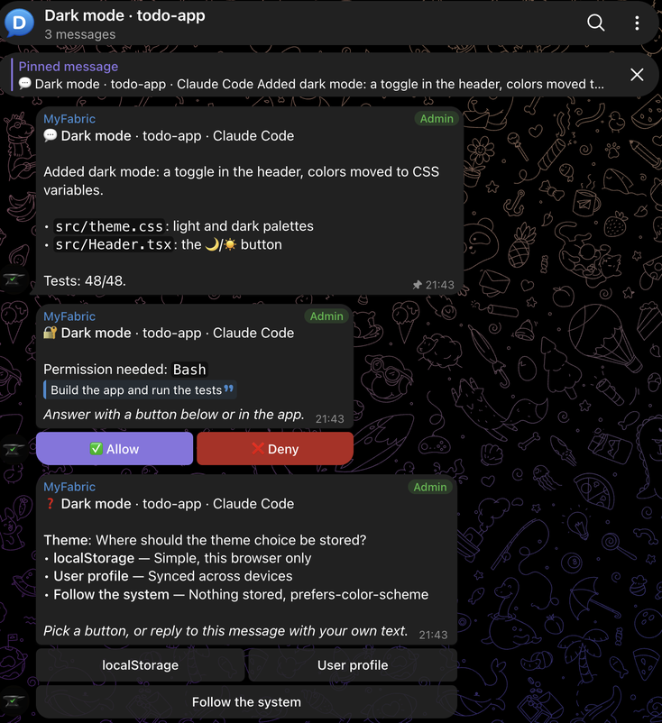

<p align="center">
  
</p>

<p align="center">
  <b>Сессии Claude Code в Discord и Telegram</b><br>
  Разрешения, вопросы и ответы прямо с телефона, пока агенты работают на вашем Mac
</p>

<p align="center">
  <a href="https://github.com/dzotyara/ai-forge/stargazers"></a>
  <a href="https://github.com/dzotyara/ai-forge/actions/workflows/test.yml"></a>
  
  
</p>

<p align="center">
  <a href="README.md">English</a> · <b>Русский</b>
</p>

> ⭐ Если AI Forge пригодился, поставьте звезду репозиторию. Так проект проще найти другим, а мне понятно, что его стоит развивать.

## Что это

AI Forge - плагин для Claude Code. Каждая сессия получает свой канал в Discord (или тему в Telegram), и всё, где агенту нужен человек, приходит туда с кнопками:

- запрос разрешения на команду или правку - «✅ Разрешить» / «❌ Отклонить»
- вопрос с вариантами (`AskUserQuestion`) - по кнопке на вариант
- «нужно ваше действие» (`ACTION_REQUIRED`) и вопрос в конце хода
- итог хода - тихо, без звука

Ответить можно текстом прямо в канале: сообщение будит сессию, и она продолжает работу. Макбук доставать не нужно.

<p align="center">
  
</p>

## Возможности

| | Discord | Telegram |
|---|---|---|
| Канал или тема на каждую сессию | ✅ приватный канал `🤖・<название>` | ✅ тема в группе |
| Кнопки разрешений и вопросов | ✅ | ✅ |
| Ответ текстом или реплаем будит сессию | ✅ | ✅ |
| Разрешить действие, заблокированное авто-режимом | ✅ | ✅ |
| Босс в общем канале, фоновые сессии по команде | ✅ `🔥・general` | ✅ General |
| Команды `/status` `/away` `/here` `/mute` | ✅ slash-команды | ✅ |
| Тишина по умолчанию, пинг только когда нужны вы | ✅ | ✅ умная доставка |
| Статус «Playing AI Forge» у бота и в вашем профиле | ✅ | - |
| Интерфейс на английском и русском | ✅ | ✅ |

Можно включить Discord, Telegram или оба сразу. В режиме «оба» запрос виден в двух местах, а решение принимается один раз.

## Скриншоты

| | |
|---|---|
|  |  |
| Разрешение и вопрос, отвеченные из Discord; подтверждение видите только вы | Босс спрашивает перед запуском фоновой сессии |
|  |  |
| Профиль Discord показывает, сколько агентов в работе | Локальная панель настроек с переключателем English / Русский |
|  |  |
| Та же сессия в теме Telegram | Разрешено и отвечено из Telegram, потом ответ текстом |

Скриншоты сняты на английском интерфейсе. Русский включается в панели настроек.

## Установка

Нужны Claude Code и Node.js 22+. Умная доставка (определение, что вы за компьютером) работает на macOS, на других ОС считается, что вас нет.

```bash
claude plugin marketplace add dzotyara/ai-forge
claude plugin install ai-forge@ai-forge
```

Откройте панель настроек:

```bash
node "$(ls -d ~/.claude/plugins/cache/ai-forge/ai-forge/*/ | tail -1)configure.mjs" --ui
```

Панель локальная: открывается на `127.0.0.1` со случайным ключом, токены целиком не показывает и никуда не отправляет. По умолчанию интерфейс на английском: выберите **Русский** в разделе **Notifications → Language**.

После установки начните новую сессию или выполните `/reload-plugins` в уже открытой.

### Discord

1. Создайте приложение в [Discord Developer Portal](https://discord.com/developers/applications). На вкладке **Bot** включите **Message Content Intent** и нажмите **Save Changes**.
2. Добавьте бота на свой сервер с правами **Manage Channels**, **View Channel**, **Send Messages**, **Read Message History**, **Add Reactions**. Чтобы бот сам поставил иконку серверу, дайте ещё **Manage Server**.
3. В панели, раздел **Discord**: токен бота и свой ID пользователя (ПКМ по себе → Copy User ID, нужен режим разработчика). ID сервера - только если бот на нескольких серверах. Нажмите **Подключить Discord**.
4. В **Уведомления → Куда отправлять** выберите **Discord** или **Telegram и Discord**, сохраните и нажмите **Тестовое сообщение**.

Бот создаст категорию `AI Forge` и канал `🔥・general`, а каналы сессий будет создавать сам. Каналы видят только вы и бот (плюс владельцы сервера через права Discord). Команды и кнопки бот принимает только от вас.

Если у бота нет аватара, а у сервера иконки, бот поставит картинку наковальни. Свои картинки он не трогает. Уведомления сервера по умолчанию бот переключит на «Только @упоминания».

### Telegram

1. Создайте бота у [@BotFather](https://t.me/BotFather).
2. Создайте группу, включите в ней **Темы**, добавьте бота и сделайте его администратором с правом «Управление темами».
3. В панели введите токен и нажмите **Найти группы**, либо запустите мастер: `node <плагин>/configure.mjs`.

Можно и без группы, в личке с ботом: тогда в @BotFather включите боту Threaded Mode, чтобы у сессий были свои темы.

## Как пользоваться

**Ответить сессии.** Напишите в её канал. Бот поставит 👀, сессия проснётся и получит ваш текст. Реплай на конкретное сообщение тоже работает. Сессия ждёт ответа до 12 часов после последнего хода.

**Разрешения.** Кнопки приходят на любой запрос разрешения. Диалог в приложении работает параллельно: кто ответил первым, тот и решил, второе сообщение помечается «Решено в приложении».

**Авто-режим.** Если классификатор авто-режима заблокировал действие, в канал придёт, что именно заблокировано и почему. «✅ Разрешить один раз» разрешает ровно этот вызов в этой сессии на 30 минут, и сессия повторит его.

**Подтверждение действий с телефона.** Ответ из чата не считается согласием на действие, которое касается других людей, например отправить сообщение, задеплоить или влить PR: Claude Code помечает ответы из чата как не ввод пользователя. Поэтому сессия не спрашивает в чате, а взводит `confirm-next` и делает точный вызов. Claude Code спрашивает разрешение, и вам приходит этот вызов с кнопками **Allow** / **Deny** и строкой «Подтвердите: …». Allow разрешает только этот вызов.

**Босс.** Назовите любую сессию «Босс» - она займёт общий канал (`🔥・general` или General в Telegram). Пишете туда задачу, Босс раскладывает её по проектным сессиям и запускает фоновые (`claude -p`) по кнопке «▶️ Запустить». Если приложение закрыло Босса, сообщение в общий канал разбудит его в фоне.

**Команды** (только от вас):

| Команда | Что делает |
|---|---|
| `/status` | режим, присутствие и список сессий |
| `/away` | присылать всё сразу, 12 часов или до `/here` |
| `/here` | умный режим |
| `/mute 30m`, `/mute 2h`, `/mute off` | пауза |

### Когда приходит уведомление

AI Forge по умолчанию молчит, пока вы за компьютером, и пингует, только когда нужны вы:

| Событие | Вас нет | Вы за Mac |
|---|---|---|
| Запрос разрешения или вопрос | сразу, с пингом | через 90 с, если не ответили в приложении |
| Нужно ваше действие | сразу, с пингом | через 180 с, если не ответили |
| Обычный ход завершён | тихо, без звука | не отправляется |

В Discord все сообщения приходят без звука, а пингуют вас только те, где нужно действие. В тихие часы (`quietHours`) упоминание остаётся, но без звука. Когда вы ответили в приложении, бот убирает упоминание из этого сообщения.

### Статус в Discord

Пока работает фоновая служба, у бота статус «Playing AI Forge · в работе: N», где N - все агенты, которые работают прямо сейчас: сессии с идущим ходом или с транскриптом, обновлённым за последние 90 секунд, дочерние и фоновые сессии и каждый работающий субагент. Если на этом Mac открыт Discord, тот же статус появляется в вашем профиле: сколько сессий в работе, сколько времени запущено, и кнопка на этот репозиторий для тех, кто смотрит ваш профиль. Для этого в Discord должно быть включено **Настройки → Конфиденциальность активности → Share my activity**.

### Несколько устройств и Codex

Счёт идёт по всем вашим устройствам. Каждое устройство держит одну строку в приватном канале `📡・presence`: имя, сколько работает агентов Claude Code и сессий Codex, когда отчиталось. Служба на каждом устройстве складывает строки не старше двух минут, а статус показывает, где идёт работа, например «Claude Code · Codex».

- Codex на этом же Mac считается по `~/.codex/sessions`.
- На устройстве, где есть только Codex, настройте AI Forge с тем же Discord-ботом. Хуки Codex запустят там маленький фоновый репортёр. Он выключится сам через 30 минут без работы.
- Устройство, которое уснуло или ушло в офлайн, выпадает из счёта через две минуты.

## Настройки

Всё задаётся в панели или в `~/.codex/telegram-action-notifier/config.json`. Отсутствующий ключ - значение по умолчанию.

| Ключ | По умолчанию | Что делает |
|---|---|---|
| `language` | `en` | `ru` — русский интерфейс |
| `notificationTarget` | `telegram` | `discord` или `both` |
| `deliveryMode` | `smart` | `always` - всегда сразу, `never` - ничего |
| `notify` | `all` | `action` - не присылать обычные ходы |
| `approvalWaitSec` | `42900` (почти 12 ч) | сколько ждать кнопку; `0` - без кнопок |
| `codexApprovalWaitSec` | `900` | сколько запрос Codex ждёт кнопку в Discord; `0` — только уведомление |
| `presenceIdleSec` / `approvalGraceSec` / `actionGraceSec` | `120` / `90` / `180` | пороги умной доставки |
| `quietHours` | нет | `{"from":"23:00","to":"08:00"}` - без звука |
| `chatReplies` | `true` | `false` - не принимать ответы |
| `telegramDenials` | `true` | `false` - не присылать блокировки авто-режима |
| `bossRevive` | `true` | `false` - не будить остановленного Босса |
| `spawnConfirm` | `telegram` | `never` - запускать фоновые сессии без подтверждения |
| `workerPermissions` | `telegram` | `auto` - фоновые сессии в режиме `auto` |
| `workerDefaults` | Sonnet 5.5, medium, `acceptEdits` | модель, effort и режим фоновых сессий |
| `discordActivity` | `AI Forge` | статус бота; `""` - без статуса |
| `discordRichPresence` | `true` | `false` - не показывать статус в вашем профиле |

## Безопасность

- Токены и ID чатов хранятся только локально (`0600`), в репозиторий и логи не попадают, секреты в сообщениях вырезаются.
- Бот слушается только владельца: чужие сообщения и нажатия молча игнорируются.
- Фоновым сессиям запрещён `bypassPermissions`. Рискованные команды они спрашивают кнопками, если вы не выбрали `workerPermissions: "auto"`.
- Статус в профиле идёт через локальный сокет Discord, без токенов.

## Codex

В Codex (0.166+) запросы разрешений приходят в Discord с кнопками **Allow** / **Deny**. Codex ждёт до 15 минут (`codexApprovalWaitSec`, 900 с), потом спрашивает в своём окне. Нажатие принимает служба на машине с Claude Code: она записывает ответ прямо в сообщение, а хук Codex читает его оттуда, поэтому это работает и с другого устройства. Telegram для Codex по-прежнему только уведомляет. После обновления перезапустите Codex и подтвердите новые хуки в **Settings → Hooks**.

```bash
codex plugin marketplace add dzotyara/ai-forge --ref main
codex plugin add ai-forge@ai-forge
```

## Разработка

```bash
node --test plugins/ai-forge/tests/*.test.mjs
```

Тесты не ходят в сеть: Telegram, Discord и сокет Discord подменяются. Версию поднимайте в обоих манифестах: `plugins/ai-forge/plugin.json` и `plugins/ai-forge/.claude-plugin/plugin.json`.

---

<p align="center">
  Понравилось? <a href="https://github.com/dzotyara/ai-forge">⭐ Поставьте звезду</a> - это лучшая благодарность
</p>
